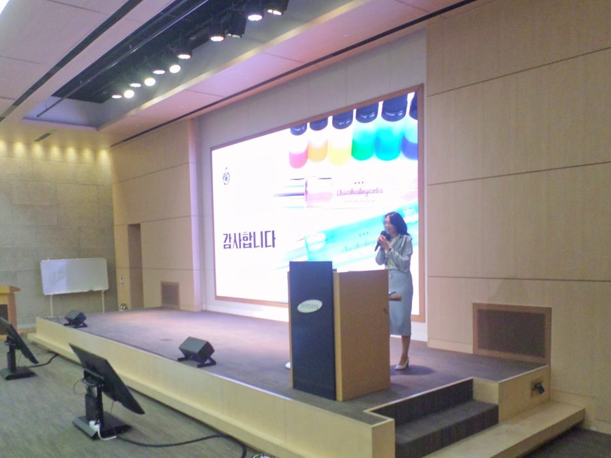

# 아넥스HR교육원 — 기업교육 랜딩 사이트

정적 사이트. 빌드 도구 없음. `index.html` 안에 CSS·JS가 모두 들어 있습니다.

```
annexhr/
├── index.html          ← 사이트 전체 (HTML + CSS + JS)
├── privacy.html        ← 개인정보처리방침 (/privacy)
├── scripts/form-handler.gs  ← 문의 폼 수신 (Google Apps Script)
├── vercel.json         ← 배포 설정 (캐시·보안 헤더)
├── robots.txt          ← 검색엔진 수집 (네이버 Yeti 포함)
├── sitemap.xml
└── assets/ (favicon.svg · og-image.png)
```

---

## 1. 배포

Vercel에 폴더째 드래그하거나 GitHub 연동 후 Deploy. Framework Preset은 **Other**, Build Command는 **비워둡니다**.

도메인 `annexhr.co.kr` 연결 시 `@` A 레코드 `76.76.21.21`, `www` CNAME은 Vercel 화면 값. canonical·OG·robots·sitemap이 이미 그 도메인 기준입니다.

---

## 2. 배포 전 교체할 값 ⚠️

사이트에서 **노란 배지**로 표시해 둔 곳입니다. 후기는 블로그 기록에서 실제 문구로 교체 완료했습니다.

| 찾을 문자열 | 바꿀 내용 |
|---|---|
| `YOUR_SCRIPT_ID` | Apps Script 웹앱 주소 — 아래 2-1절 |
| `privacy.html`의 `2026-00-00` | 개인정보처리방침 시행일 |

> 네이버 톡톡(`talk.naver.com/profile/w4m5ao`)은 입력 완료. 외부 플랫폼 후기 링크는 넣지 않기로 하여 블록 자체를 삭제했습니다.

---

## 2-1. 문의 폼 연결 — Google Apps Script (무료)

`scripts/form-handler.gs` 에 코드가 들어 있습니다. 문의가 **스프레드시트에 쌓이고 동시에 메일로** 옵니다. 비용 0원, 건수 제한 없음(메일만 하루 100통).

1. 구글 드라이브에서 **새 스프레드시트** 생성
2. **확장 프로그램 → Apps Script** → `scripts/form-handler.gs` 내용을 전부 붙여넣기
3. 맨 위 `NOTIFY_TO` 를 받을 주소로 수정 (기본값 `annexhredu@gmail.com`)
4. **배포 → 새 배포 → 유형: 웹 앱**
   - 실행 계정: **나**
   - 액세스 권한: **모든 사용자** ← 이게 아니면 폼이 안 됩니다
5. 나오는 `.../exec` 주소를 `index.html` 의 `YOUR_SCRIPT_ID` 자리에 교체

```html
<form ... action="https://script.google.com/macros/s/AKfycb.../exec" method="POST">
```

6. 배포 후 **직접 한 번 제출**해서 메일과 시트를 확인

> 첫 배포 때 "이 앱은 Google에서 확인하지 않았습니다" 경고가 뜹니다 — 본인이 만든 스크립트라 정상입니다. **고급 → 이동**으로 진행하세요.
>
> 폼은 `mode:"no-cors"` 로 전송합니다. Apps Script 웹앱이 리다이렉트를 거쳐 CORS 응답을 주지 않기 때문입니다. 브라우저가 응답 본문을 읽지 못하므로 **전송 성공 여부는 시트로 확인**하세요. 네트워크 자체가 끊기면 오류 메시지가 뜹니다.
>
> 연결 전까지는 제출 시 "아직 연결되지 않았습니다 + 전화·이메일" 안내가 떠서 문의가 유실되지 않습니다.

**자동 회신을 넣으려면** `doPost` 안 `MailApp.sendEmail` 아래에 한 블록 더 추가하면 됩니다. 필요하시면 말씀해 주세요.

---

## 2-2. 현장 사진 12장

`assets/`에 넣고 `index.html`의 해당 자리를 교체하면 됩니다. **가로:세로 4:3, 가로 1200px 이상, 장당 300KB 이하** ([squoosh.app](https://squoosh.app)로 압축).

블로그 글에서 추출해 **12장 모두 적용 완료**입니다. 얼굴은 원본에서 이미 모자이크 처리돼 있어 초상권 문제가 없습니다.

| 파일 | 출처 | 내용 |
|---|---|---|
| `case-01.jpg` | 삼성SDI | 조직력강화 행사 강의 무대 |
| `case-02.jpg` | 넥슨코리아 | 컬러 카드 작업 테이블 (판교 본사) |
| `case-03.jpg` | 건강보험심사평가원 | 대규모 강의장 전경 |
| `case-04.jpg` | 한수원 방사선보건원 | 하바리움펜 제작물 |
| `case-05.jpg` | 원주의료원 | 컬러·향료 재료 세팅 |
| `case-06.jpg` | 제주항공 서울본사 | 레인보우 프리즘 보드게임 진행 |
| `case-07.jpg` | 한국장애인고용공단 | 연회홀 원탁 배치 · 160명 규모 전경 |
| `case-08.jpg` | 경기도인재개발원 | 셀프 진단 컬러테라피 재료 세팅 |
| `case-09.jpg` | 강원 노인맞춤돌봄서비스 | 행사 현수막 + 강의 전경 (2024.10.24 호텔인터불고 원주) |
| `case-10.jpg` | 한국표준협회 | 퓨처밸류캠퍼스 강남 강의 전경 (KSA 로고 화면) |
| `case-11.jpg` | 서울시교육청 교육연수원 | 힐링테라피 7~8기 강의 전경 (2024.8.28~29). 총 4회 = 종일형 2회 + 3시간 2회 |
| `case-12.jpg` | 서울시교육청 늘봄지원실장 연수 | 양평 블룸비스타 연회장 100명 전경 (2025.5) |

**제작물 썸네일 `item-01~08.jpg`** (600×600, Company Profile·컬러센트 브로슈어에서 추출): 컬러 센트 향수 · 하바리움 플라워 바틀 · 하바리움 플라워 펜 · 오일파스텔 드로잉 · 컬러 미니 아로마 디퓨저 · 아로마 플라워 디퓨저 · 컬러 아로마 디퓨저 T · 컬러 아로마 디퓨저. 아트테라피 탭에 8종, 명상·힐링 탭에 4종(오일파스텔·디퓨저 3종) 노출. 소주잔·티코스터·석고 방향제·롤온 향수는 대표 결정으로 제외.

모두 4:3 / 1200×900 / 300KB 이하로 변환했습니다. 교체하실 때도 같은 규격을 지키세요.

```html
<!-- 이 부분을 -->
<div class="case__img">현장 사진 01<br>4:3</div>

<!-- 이렇게 -->
<div class="case__img" style="padding:0">
  
</div>
```

> 얼굴이 나오는 사진은 초상권 동의가 필요합니다. 동의가 어려우면 **뒷모습·손·결과물 위주**로 고르세요. 결과물 사진이 오히려 프로그램을 잘 보여줍니다.

### 후기 문구 출처

`#reviews`의 6건은 전부 자사 블로그에 이미 공개된 현장 기록에서 그대로 옮긴 것입니다. 새 후기를 추가하실 때 규칙:

- **개인 성함·직함은 쓰지 않습니다.** `기관명 · 프로그램명 · 참가자` 형태까지만.
- 기관명을 밝히는 건 **이미 블로그·웹사이트에 공개한 출강처**일 때만.
- 담당자 발언(사전 요청·통화 기록)은 참가자 후기와 섞지 말고 `담당자 사전 요청`처럼 출처를 명시.
- 원문을 다듬더라도 **없던 말을 만들지 않습니다.** 맞춤법·띄어쓰기 교정까지만.

| 현재 게시 문구 | 출처 글 |
|---|---|
| "요즘 제 상태랑 똑같아서 놀랐어요" 외 1건 | 수원 경기도인재개발원 컬러테라피 강의 후기 |
| "저 사람은 저런 사람이었구나" | 같은 글 (컬러링 코드 세션) |
| "잠시나마 마음 편히 쉴 수 있는 시간" | 2025 장애인취업성공패키지 상담사 역량강화 워크숍 |
| "만든 펜을 책상에 두고" | 경기도인재개발원 글 (하바리움 플라워 펜) |
| "AI를 어떤 식으로 길들여야 하는지" | 브랜드 블로그 AI 챗봇 자동화 워크숍 1기 후기 |
| "다른 지역 센터에서도 강의를 요청드려요" (재요청·와이드 카드) | 서울 중장년 내일센터 셀프진단 컬러테라피 후기 — 담당자 피드백 |
| "커스터마이즈된 기념품이 남아서" 외 2건 | 한국표준협회 3회 특강 후기 — 담당자 카톡 캡처 + 참가자 설문 캡처 |
| "다음엔 우리 부서 전체가 함께하고 싶어요" (재요청·와이드 카드 2) | 서울교육청 초등특수늘봄지원실장 소통 힐링 교육 기록 |

> 폼은 페이지 이탈 없이 전송하고 결과를 인라인 표시합니다. JS가 막히면 일반 POST로 폴백합니다.
> `YOUR_FORM_ID`를 안 바꾼 채 제출하면 조용히 실패하지 않고 전화·이메일 안내를 띄웁니다.

---

## 3. 프로그램 구성 (6포맷)

| 포맷 | 시간 | 인원 | 시작가 |
|---|---|---|---|
| 성격유형진단 | 90~120분 + 사전검사 | 12~50명 | 66만원~ |
| 명상·힐링 (아로마 디퓨저 / 오일파스텔) | 90~120분 | 12~40명 | 57만원~ |
| 아트테라피 | 90~120분 | 12~150명 | 57만원~ |
| 컬러 보드게임 (레인보우 프리즘) | 180분 | 12~100명 (조별 6~8명) | 61만원~ |
| AI·업무역량 | 120~180분 | 10~30명 (개별 실습) | 65만원~ |
| 종일형 (조합) | 4~6시간 (중식 제외) | 10~150명 | 120만원~ |

> AI 라인에 **AIW-301 콘텐츠 마케팅·브랜딩**을 추가했습니다. 2012년부터의 마케팅 실무와 소상공인·보험설계사 SNS 전략 특강 이력이 근거입니다.

**인원 상한은 장소가 정합니다.** 연회홀·대강당이면 100명 이상도 한 번에 진행하고, 공간이 나뉘어 있거나
부서별로 따로 받고 싶으면 회차를 나누거나 교실을 나눠 동시에 운영합니다 (한국장애인고용공단 160명 = 2회 분할).
분반은 제약이 아니라 선택지이므로 사이트에도 그렇게 썼습니다.

오일파스텔만 개별 지도가 필요해 40명, AI는 개별 화면을 봐야 해 30명이 상한입니다.

---

## 4. 견적 산정 기준 (내부용 — 사이트 비공개)

```
견적 = 기본 강사비 + 진단비(인원×) + 재료비(인원×) + 보조강사비 + 출장비
```

| 항목 | 청구 | 원가 |
|---|---|---|
| 기본 강사비 | 40만원 (2~3시간) / **보드게임 180분 50만원** / 전일제 100만원~ | — |
| 진단비 | 3~5천원 / 인 | 인쇄비 수준 |
| MBTI 정식검사 | 1.5만원 / 인 | 검사지 1~1.2만원 → **마진 3~5천원** |
| 에니어그램 (한국형에니어그램 온라인 진단지) | 1.0만원 / 인 | 사전 온라인 실시 (대표 확정) |
| 컬러 센트 향수 10ml / 30ml | 1.5만 / 2만원 / 인 | 청구가의 1/2 |

> **향수 제품명은 "컬러 센트 향수"로 통일했습니다.** 이전에는 니치 향수 · 컬러 향수 · 컬러센트 · 시그니처 센트가 섞여 있어 담당자가 같은 것인지 헷갈릴 수 있었습니다. 앞으로 문구를 고치실 때도 이 이름을 쓰세요.
>
> 별개 활동인 **아로마 조향**(HLG-201)과 **명리 조향**(ART-201)은 진단 방식이 달라 이름을 그대로 뒀습니다.
>
> **MBTI 기반 향수는 "MBTI 맞춤 향수"** 입니다(PSN-201). 컬러 진단이 들어가지 않는 구성이라 "컬러 센트"를 붙이지 않습니다. 한국표준협회·늘봄지원실장 사례 카드도 이 표기를 씁니다.
| 오일파스텔+액자 | 2.5만원 (21명~ 2만원, **누진**) | 청구가의 1/2 |
| 하바리움펜·디퓨저·키링 | 1만원 / 인 | 청구가의 1/2 |
| 보드게임 워크시트 | 5천원 / 인 | — |
| 보조강사 | 15만원 / 인 (**21명부터**, AI는 **10명부터 필수**) | 15만원 지급 |
| AI 유인물 | 5천원 / 인 | 인쇄비 수준 |

> **종일형 (조합) 산식** — 전일제 강사비 100만원(6시간) + 재료비(인당) + 보조강사(21명부터 10명당 1인) + 출장비.
> 사이트 표는 재료 1만원(제작 1종) / 2만원(제작 2종) 기준이며, **10명 이하는 산식보다 종일 최소 금액(120만원)이 우선**입니다. 컬러 센트 향수 30ml나 오일파스텔을 고르면 재료 단가가 올라가니 견적서에서 다시 잡으세요.
> 150명 이상과 다교실 동시 진행은 주강사가 늘어 산식이 달라지므로 표에 올리지 않았습니다(SCK 90명 건이 그 경우 — 단, 아래 주의 참고).

> 문의 폼에 **희망 패키지**(라이트·스탠더드·프리미엄) 항목이 있습니다. 패키지 카드의 "○○로 문의" 버튼을 누르면 그 값이 자동으로 선택돼 문의에 실립니다 — 담당자가 생각한 예산대를 보고 견적을 쓰실 수 있습니다.
| 출장비 | 수도권 5~8만원 · 부산·제주 등 원거리 10만원~ (숙박 실비 별도) | 실비 |

### 검증된 실거래

SCK 법인그룹 90명 450만원 = 30명 반 3개 × 약 150만원. 산식 오차 **2%**.

> ⚠️ **SCK 건은 다른 업체와 나눠 진행한 행사입니다.** 그래서 사이트에서는 기관명만 남기고 "90명 · 2개 교실 동시 진행" 설명을 뺐습니다. 담당자가 레퍼런스 확인 전화를 하면 바로 드러나는 종류의 과장이라, 이름 하나 남기는 게 낫습니다.
> 위 450만원이 **우리 몫 청구액**이면 산식 검증은 그대로 유효하고, **행사 전체 금액**이면 다시 봐야 합니다. 확인 필요.

### 손봐야 할 두 구간

**① MBTI 정식검사는 붙여도 거의 남지 않습니다.**

검사지 원가가 1~1.2만원인데 1.5만원에 청구하시니 1인당 마진이 **3~5천원**입니다. 결과 해석에 50분을 쓰는 대가로는 적습니다.

| 20명 기준 | 견적 | 강사 몫 |
|---|---|---|
| MBTI 강의형 (검사 없음) | 78만 | 55.0만 |
| MBTI 정식검사 | 108만 | 61.0만 |

**견적은 30만원 오르는데 손에 남는 건 6만원입니다.** 검사비를 **2만원**으로 올리시면 같은 20명 건이 118만 견적에 강사 몫 71만원이 됩니다. 공식 도구라는 신뢰가 붙는 값이라 가격 저항이 적은 항목입니다.

**② AI는 유인물비(5천원/인)가 붙어 인원 비례가 생겼습니다.** 다만 보조강사비를 원가 그대로 전가해 증가가 느립니다 — 10명 44만 → 30명 52만. 보조강사비를 20만원 청구(15만 지급)하면 그 기울기가 살아납니다.

**③ 재료비 할인은 반드시 누진으로.** 구간 할인을 전체 인원에 소급하면 29명 135.5만 > 30명 123.0만으로 총액이 역전됩니다. 한 명 더 받으면 12.5만원을 잃습니다.

---

## 4-1. 소속 강사 편성(파견) — 수수료 구조 (내부용 — 사이트 비공개)

**왜 하는가.** 1인 기업의 가장 큰 손실은 "그날 이미 강의가 있어서" 놓치는 건입니다. 문의 자체는 들어왔는데 캘린더 때문에 매출이 0이 되는 구조를 없애는 게 목적입니다.

### 원칙

| | |
|---|---|
| 고객 청구가 | **공개 가격표 그대로. 할인 없음** |
| 센터 수익 | 청구가 − (강사 지급 + 재료 원가 + 보조강사 + 출장 실비) |
| 재료·진단 마진 | 전액 센터 (조달·배송을 센터가 하므로) |
| 보조강사비 | 실비 통과 (15만원 청구 = 15만원 지급) |
| 컬러 보드게임 | **지도사 이수 + 교구 보유 강사만**. 센터 대여 없음 (아래) |

고객에게 **같은 금액**을 받는 이유: 이 사이트가 가격을 정당화하는 근거는 "대표강사가 설계한다"이지 "대표강사가 몸으로 간다"가 아닙니다. 설계·상담·교구·사후 정리가 그대로면 값을 깎을 이유가 없습니다. 한 번 깎아주면 그다음부터 전부 그 가격이 기준이 됩니다.

### 강사 지급 기준 — 권장: 청구 강사비의 60~70%

기본 강사비가 이미 난이도·시간을 반영(2~3시간 40만 / 보드게임 180분 50만 / 전일제 100만~)하고 있어, 정액표를 따로 만들 필요 없이 **요율 하나로 전 과정이 자동 반영**됩니다.

아래는 65% 기준입니다.

**① 아트테라피 30명 (하바리움펜 1만원/인) · 출장 8만**

| | 직접 출강 | 소속 강사 편성 |
|---|---|---|
| 고객 청구 | 93만 | 93만 |
| 재료 원가 | −15만 | −15만 |
| 보조강사 | −15만 | −15만 |
| 출장 실비 | −8만 | −8만 |
| 강사 지급 | — | −26만 |
| **센터에 남는 금액** | **55만** | **29만** |

**② 컬러 센트 향수 30ml 50명 · 출장 8만**

| | 직접 출강 | 소속 강사 편성 |
|---|---|---|
| 고객 청구 | 193만 | 193만 |
| 재료 원가 | −50만 | −50만 |
| 보조강사 | −45만 | −45만 |
| 출장 실비 | −8만 | −8만 |
| 강사 지급 | — | −26만 |
| **센터에 남는 금액** | **90만** | **64만** |

> 인원이 클수록 수수료가 커집니다. 강사 지급은 고정인데 **재료 마진이 인원에 비례**하기 때문입니다. 즉 **파견은 큰 건일수록 유리**합니다. 날짜가 겹쳤을 때 어느 쪽을 직접 가실지 고민되면, **재료 구성이 가벼운 건을 파견**으로 돌리는 편이 총액이 큽니다.

### 강사와의 관계 — 묶지 않습니다 (대표 결정)

일반적인 파견업은 재출강 센터 경유·교구 2차 사용 금지를 계약서에 넣지만, **여기서는 둘 다 넣지 않습니다.**

| 항목 | 방침 | 근거 |
|---|---|---|
| 재출강을 강사가 직접 받는 것 | **허용** | 한 번 가서 강사 역량으로 다시 불린 거면 그 강사 몫 |
| 진단 워크시트·향수 레시피 사용 | **허용** | 자격과정을 정식 이수한 분들이라 쓰라고 가르친 것 |

이게 성립하는 이유는 **자격과정이 본업이고 파견은 그 생태계의 부가 수익**이기 때문입니다. 강사를 묶는 모델이 아니라 길러내는 모델이라, 비경쟁 조항을 걸면 오히려 강사가 떠납니다.

**실제로 모델을 지키는 건 계약서가 아니라 구조입니다.**

1. **교구 조달이 사실상 센터를 거칩니다.** 레인보우 프리즘은 판매하고 있지만 일반 강사가는 **개당 8만원**이고, 한 반을 돌리려면 10개 내외가 필요합니다 — **초기 교구값만 80만원**입니다. 한국컬러인마인드 소속 외에는 구매 경로도 제한적이라, 누가 몇 개를 샀는지 센터가 전부 파악합니다. 비경쟁 조항보다 이 **단가 × 수량 × 채널** 구조가 실질적인 진입장벽입니다. 대형 강의를 돌릴 만큼 물량을 갖춘 사람은 센터가 이미 알고 있습니다.
2. **자격과정이 보수교육·갱신으로 이어집니다.** 강사가 센터와 계속 연결될 이유가 계약이 아니라 실익에 있습니다.
3. **대형 건은 혼자 못 받습니다.** 90명·160명 규모는 보조강사 편성·재료 조달·운영 인력이 필요해 센터를 거칩니다. 개인이 가져갈 수 있는 건 소규모 반복 건입니다.

### 교구는 빌려주지 않습니다 (대표 결정)

보드게임 파견은 **레인보우 프리즘을 이미 보유한 지도사**에게만 보냅니다. 센터 대여는 하지 않습니다.

- **관리가 안 됩니다.** 세트당 10개 내외를 배송·회수하고 분실·파손·누락을 매 건 확인해야 합니다. 수수료 29~64만원짜리 건에 붙이기엔 품이 과합니다.
- **성의가 곧 필터입니다.** 교구값 80만원을 선투자한 강사는 이미 이 프로그램으로 먹고 살 의지가 있는 사람입니다. 그 정도도 안 갖춘 분은 애초에 현장에 보낼 이유가 없습니다.
- **수수료 계산이 단순해집니다.** 대여료라는 변수가 사라져 요율 하나로 끝납니다.

> **부수 효과 — 교구 판매가 곧 파견 풀입니다.** 사는 사람이 일 받는 사람이 되므로, 80만원이 비용이 아니라 회수되는 투자가 됩니다. 지도사 과정 모집할 때 쓸 수 있는 논리이기도 합니다.
>
> 대신 **누가 몇 세트를 보유 중인지 명부**는 센터가 들고 있어야 합니다. 지금은 판매 기록으로 추적 가능하지만, 파견이 늘면 별도로 관리하세요.

그래서 **계약서에 남길 건 품질과 책임뿐입니다.**

- **사고·클레임 책임 소재** — 재료 안전사고, 노쇼·지각 시 처리 기준
- **진행 기준 준수** — 센터 이름으로 나가는 건이므로 커리큘럼 구성·교구 세팅·사후 보고 양식은 동일하게
- **미검증 강사 투입 금지** — 자격 미이수자에게 재하청하지 않을 것

### 아직 정하지 않은 것

- 요율을 60%로 할지 70%로 할지 (65% 기준 예시입니다)
- 수도권 외 지역 파견 시 출장비를 강사에게 실비로 더 줄지, 요율에 포함할지
- 파견 건 사후 보고(만족도·사진)를 강사가 쓸지 센터가 쓸지
*(보드게임 교구 대여 여부는 결정 완료 — 대여하지 않습니다. 위 "교구는 빌려주지 않습니다" 참고)*

---

## 4-2. 과정별 커리큘럼 표·기대 효과·견적표 (칩 클릭 시 교체)

프로그램 상세에서 과정 코드를 누르면 미리보기 카드와 함께 **커리큘럼 예시 표와 기대 효과가 그 과정 것으로 바뀝니다.** 데이터는 `index.html`의 `CURR`(시간표)·`EFF`(기대 효과) 객체입니다. 기대 효과는 조직성향힐링워크숍 제안서 Ver 202512의 프로그램 소개·추천 대상 문구를 기준으로 썼고, 제안서에 없는 과정(AIW·FDY·HLG-101/201/202·ART-102/103·PSN-101/102)은 사이트 기존 문구에서 뽑았습니다. AIW-101·FDY-101은 패널 기본 기대 효과를 그대로 씁니다.

| 출처 | 과정 |
|---|---|
| **실제 강의계획서·현장 기록** | GME-101(닥터자르트 180분) · PSN-201 / ART-101(서울시교육청 컬러 센트) · HLG-102(오일파스텔) · HLG-202(정선·중장년 3부) · ART-103(경기도인재개발원) · AIW-101 · FDY-101(교육연수원 종일) · FDY-301(늘봄지원실장 4단계) · AIW-301(AI 챗봇 워크숍 4시간) |
| **같은 틀에서 활동만 바꾼 구성 — 확인 필요** | PSN-101 · PSN-102 · PSN-301 · HLG-101 · HLG-201 · ART-102 · ART-201 · AIW-102 · AIW-201 · FDY-102 · FDY-201 |

두 번째 줄은 실제 계획서를 주시면 그대로 바꿔 넣겠습니다. 시간 합계는 전부 코드 옆 표기와 맞춰 두었습니다.

**견적표(`PRICE`)** 는 10개 과정에 따로 두었고 나머지는 패널 기본 표를 씁니다. 산식은 4절과 동일(강사비 40만 + 1인당 항목 + 보조강사 + 출장비). 1인당 단가는 기존 표에서 가져왔지만 아래 셋은 **추정이라 확인이 필요**합니다.

| 과정 | 추정한 단가 |
|---|---|
| HLG-201 아로마 조향 (롤온) | 재료 1.0만/인 — 디퓨저와 같다고 가정 |
| PSN-101 강의형 · PSN-102 · HLG-101 | 진단지·워크시트 0.5만/인 — 진단비 3~5천 기준 |
| ART-201 명리 조향 | 향수 30ml 2.0만/인 — 컬러 센트 30ml와 같다고 가정 |

FDY-102(반일)·FDY-201(다교실)·AIW-102/201/301은 강사비 기준이 달라 표를 만들지 않았습니다(패널 기본 표 유지).

---

## 5. 외부 플랫폼(위버)과의 관계 ⚠️

같은 프로그램이 위버에 등록돼 있습니다. **문구가 같으면 검색에서 이 사이트가 집니다** — 구글이 도메인 힘이 센 위버를 대표로 뽑고 `annexhr.co.kr`은 색인에서 밀립니다.

| 구분 | 처리 |
|---|---|
| 시간 배분·인원·재료 사양·자격증명 | 사실이므로 그대로 |
| 소개 문구·소제목·기대 효과 | 전부 새로 작성 (원문과 14자 이상 일치 0건) |
| 관점 | 참가자 경험 → **발주 담당자**(운영 부담·보고·견적) |
| 위버 후기 본문 | 옮기지 않고 링크로만 연결 |

**가격은 위버보다 낮게 걸지 마세요.** 다만 더 비싸게도 걸지 마세요 — 담당자가 싼 쪽(위버)으로 가면 수수료를 내게 됩니다. 동일가가 최적입니다.

> ⚠️ 위버 표시가는 **최저 옵션 기준**이라 실거래와 벌어집니다 (MBTI 향수 30명 65만원은 5ml 기준이며 거의 주문되지 않음). 단가를 올리실 때 **위버 등록가를 먼저 맞추신 뒤** 사이트를 띄우세요.

---

## 6. 개인정보처리방침

`/privacy`로 붙어 있고 푸터에서 링크됩니다. 문의 폼으로 개인정보를 받으므로 **필수**입니다.

확인할 세 가지 — ① 시행일 ② 위탁업체 표(실제 쓰는 서비스만, 국외 이전 문구는 유지) ③ 보유 기간이 폼 동의 문구(3년)와 일치하는지.

---

## 7. 확인이 필요한 값

- [ ] **MBTI 검사비를 2만원으로 올릴지 결정** (현재 1.5만원 = 마진 3~5천원)
- [ ] 키프리스에서 “아넥스HR교육원” 상표 조회 (교육서비스업 제41류)
- [ ] 네이버 스마트플레이스 등록

**확정된 것** — 협회 직함(컬러웰니스협회 협회장 · 한국AI평생교육협회 부회장) · 네이버 톡톡 · 보드게임 워크시트 5천원 · AI 유인물 5천원 · 출강 기관 실명 노출 · **강의 경력 18년차**(블로그 최신 글 기준) · 제주항공은 **서울본사**로 표기

---

## 8. 배포 당일 할 일

1. **Google Search Console** — 소유권 확인 → `sitemap.xml` 제출 → 색인 생성 요청
2. **네이버 서치어드바이저** — 사이트 등록 → 사이트맵 제출 + 웹페이지 수집 요청 (네이버는 색인이 느리니 먼저)
3. 카톡으로 자기 자신에게 도메인 전송해 썸네일 확인 (안 뜨면 [카카오 캐시 초기화](https://developers.kakao.com/tool/clear/og))
4. 폼 제출 테스트 1회 + 모바일 전체 스크롤 1회

---

## 9. 사업자 · 결제 구조

운영 주체는 **원주채아힐링센터**, 노출 브랜드는 **아넥스HR교육원**입니다. 푸터와 JSON-LD 양쪽에 명시해 뒀습니다 — 견적서 상호와 사이트 이름이 달라도 담당자가 헷갈리지 않습니다.

기업·공공은 교육 후 세금계산서 → 계좌이체가 기본이고, 법인카드는 채아힐링센터 아임웹 자사몰에서 개인결제창 링크를 발행합니다. 이 사이트에 결제창을 붙이지 않은 건 의도적입니다 — 카드 결제창이 보이면 B2C 원데이클래스처럼 읽혀 단가 협상에서 불리합니다.
